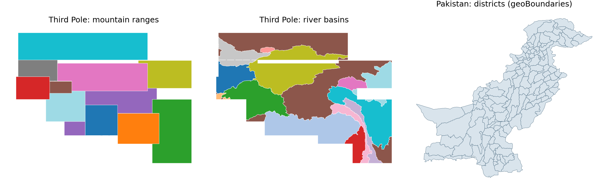

# Shared geodata

Boundary files that I reuse across projects, in GeoJSON (WGS 84), free for others to use.



| File | Contents | Source | Licence |
|---|---|---|---|
| `data/third_pole/third_pole_regions_v1.geojson` | Third Pole domain (1), mountain ranges (11), river basins (14), with land area in km2 | Ranges are my own boxes clipped to a mountain mask. Basins are built from HydroBASINS. | CC BY 4.0; credit HydroSHEDS for basins |
| `data/pakistan/pakistan_adm2_geoboundaries.geojson` | Pakistan districts (126 units) | geoBoundaries | CC BY 4.0; credit geoBoundaries |

The range polygons are a first approximation drawn from rectangles, so they suit overviews and regional summaries. For precise mountain limits use GMBA Mountain Inventory v2 or the ICIMOD HKH boundary.

Boundaries in disputed areas, Kashmir included, follow the source data and imply no position on any claim.

## Use

```python
import geopandas as gpd
base = "https://raw.githubusercontent.com/AhmadAmmar/shared-geodata/main/data"
regions = gpd.read_file(f"{base}/third_pole/third_pole_regions_v1.geojson")
ranges = regions[regions.level == "range"]
```

The scripts that built the regions are in [earth-engine-code](https://github.com/AhmadAmmar/earth-engine-code).
